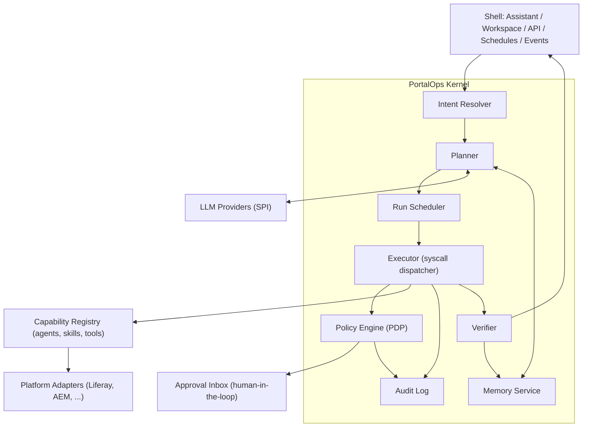
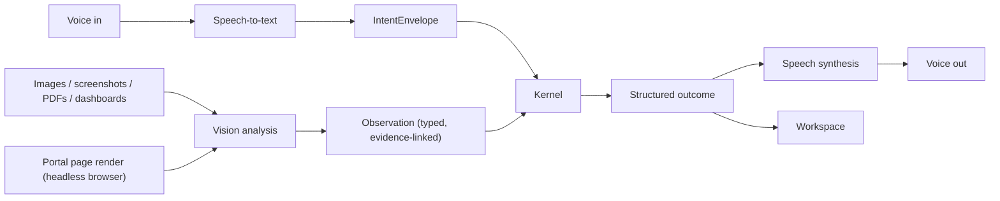
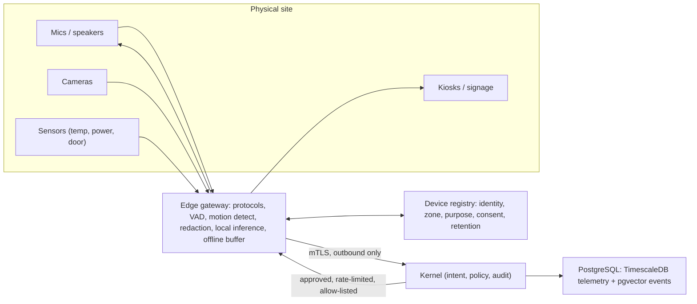
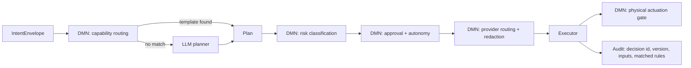

# PortalOps Agent OS

Status: Proposed. See [ADR index](../adr/README.md).

PortalOps expands from an assistant-first diagnostics tool into a full portal management and operations platform. The organizing idea is an **Agent OS**: PortalOps is the operating system and "brain"; LLMs are replaceable reasoning engines running on top of it.

```text
Intent -> Plan -> Governed Execution -> Findings -> Workspace -> Approved Actions -> Verification -> Memory
```

This extends the existing `Intent -> Investigation -> Findings -> Workspace -> Actions` model. It adds planning, approval, verification, and learning.

## Principles

1. **The kernel decides, the model proposes.** The LLM never calls tools, reads data, or changes state directly. It emits proposals that the kernel validates and executes.
2. **Every effect is a syscall.** Reads and writes go through one mediated path: authorize, execute, audit.
3. **Governance is authoritative.** Policy is enforced in code, not in prompts.
4. **Least privilege and least autonomy.** Agents act with the requesting user's permissions. Write actions need approval unless a policy explicitly grants autonomy.
5. **Everything is auditable and replayable.** Each run is a persisted process with a full trace.
6. **Provider and platform independence.** LLMs and portal platforms are both behind SPIs.

## Review of the current code base

Findings from reviewing `modules/` (22 bundles, about 199 Java files):

| Area | Current state | Gap for Agent OS |
| --- | --- | --- |
| Routing | `PortalOpsAssistantServiceComponent` uses keyword checks (`_isUserManagementPrompt`, `contains("user")`, and similar) in a fixed if-chain. | Not extensible, ambiguous (a prompt can match several domains), single-agent per prompt, no planning. |
| Agent wiring | Five near-identical blocks, one per agent, each with its own error handling and payload mapping. The service module depends on every `agent-*` module. | Adding a domain means editing the kernel. Needs registry-based dispatch. |
| Contracts | `portalops-api` defines `PortalOpsAgent`, `PortalOpsSkill` and `PortalOpsTool` (metadata only). Each `agent-*` module re-declares its own `AgentRequest`, `AgentResponse` and `Skill`. Tools have no schema, risk class or permission requirement. | No uniform invocation contract, so the kernel cannot generically call, validate, authorize or audit. |
| LLM use | The agent runs first, then OpenAI summarizes the result (`_completeWithOpenAI`). | The model is a summarizer only. It does not plan, choose tools or iterate. |
| Governance | `CommandAuthorizer` allows everything except `UNSUPPORTED`. `AuditRecorder` is a stub. `portalops-policy`, `-audit`, `-permissions` and `-knowledge` each hold one stub class. | The governance and audit pillars exist only as interfaces. |
| Command path | A second, parallel route (`portalops-command`, `PortalOpsCommandType` enum) is separate from the assistant path. | Two intent systems. They should converge on one. |
| Knowledge | Docs disagree: `ai-architecture.md` says ChromaDB, `ROADMAP.md` says PostgreSQL and pgvector. `PortalKnowledgeService` is a snapshot, not retrieval. | No retrieval, no memory. Needs a decision (ADR-0006). |
| Actions | All capabilities are read-only. The matrix lists actions as Future. | Operations (write) is the core of the expansion. |
| Stub bundles | `portalops-content`, `-search`, `-site`, `-service`, `-workflow`, `-permissions` are placeholders. | Platform adapters are missing. Agents call Liferay services directly. |
| Web | The portlet uses a mock dashboard provider and a right-rail assistant. | Needs a workspace renderer, an approval inbox and a run viewer. |

Strengths to keep: OSGi modularity, the Agent -> Skill -> Tool vocabulary, the provider SPI (`portalops-llm-spi`), structured response payloads, and the principle that AI does not own the UI.

## Kernel model

| OS concept | PortalOps equivalent | Responsibility |
| --- | --- | --- |
| Kernel | `portalops-kernel` | Owns the run loop, scheduling, syscalls and policy hooks. |
| Process | **Run** (investigation or operation) | Has an id, owner, goal, plan, state, budget and trace. |
| Scheduler | Run scheduler | Interactive, scheduled (cron) and event-driven runs. Applies quotas, concurrency and cost budgets. |
| Syscall table | **Tool registry** | The only way to touch the portal, knowledge or external systems. |
| Drivers | **Platform adapters** | Liferay first. AEM, WordPress and Drupal later. |
| Filesystem and memory | **Memory service** | Working, episodic, semantic and procedural memory. |
| Permissions and SELinux | **Policy engine (PDP)** | Allow, deny or require approval, with obligations. |
| Syslog | **Audit log** | Append-only, tamper-evident, correlated by run id. |
| Shell | Assistant, workspace and API | Intent in, structured outcome out. |
| Senses (input devices) | **Perception services**: speech-to-text, vision | Turn voice, images, screenshots and documents into typed observations. |
| Voice (output devices) | **Speech synthesis** and spoken briefings | Speak findings, ask for approval, read back actions. |
| Userland programs | Agents and skills (modules) | Domain behavior contributed by OSGi bundles. |
| CPU | LLM provider(s) | Reasoning engine behind `portalops-llm-spi`. |



### The run lifecycle

1. **Intake.** The shell creates an `IntentEnvelope` (text or structured intent, requester, scope, trigger type).
2. **Resolve.** The intent resolver matches the intent against registered capabilities and returns a ranked candidate set (ADR-0003).
3. **Plan.** The planner (LLM-assisted) produces a plan: ordered or parallel steps, each naming a capability and its arguments. Plans are data (JSON). The planner only sees capabilities the requester may use.
4. **Authorize.** For every step the policy engine returns `ALLOW`, `DENY` or `REQUIRE_APPROVAL`, plus obligations such as redaction or a rate limit (ADR-0005).
5. **Execute.** The executor runs each tool through the syscall path. Read steps run immediately. Write steps become **action proposals**.
6. **Observe and iterate.** Tool results return to the planner within budget limits (steps, tokens, wall time). A bounded loop replaces the single-shot design.
7. **Approve.** Proposals appear in the approval inbox with evidence, a diff or dry-run preview, a risk tier and a rollback plan. Approving is a human act. Policy can pre-approve low-risk classes (ADR-0007).
8. **Act and verify.** The kernel executes approved actions, then runs a verification step that re-reads state and compares it with the expected outcome. A failed verification triggers rollback or escalation.
9. **Report and remember.** The kernel emits a structured outcome (findings, recommendations, actions, evidence) and writes an episodic memory record.

### Syscall contract (tool invocation)

All tools implement one contract, replacing today's per-module `Skill`, `AgentRequest` and `AgentResponse` types (ADR-0004).

```text
ToolDescriptor
  name, version, domain, description
  inputSchema, outputSchema        (JSON Schema)
  effect:        READ | WRITE | DESTRUCTIVE | EXTERNAL
  riskTier:      0..3
  requiredPermissions[]            (Liferay permission actions)
  idempotent:    boolean
  dryRunSupported: boolean
  compensation:  optional rollback tool reference
  dataClassification: PUBLIC | INTERNAL | PII | SECRET
ToolInvocation  (runId, stepId, principal, args, mode: DRY_RUN | EXECUTE)
ToolResult      (status, data, evidenceRefs[], errorCode, costMetrics)
```

Rules:

- The executor validates arguments against `inputSchema` before dispatch.
- The executor checks the requester's Liferay permissions in addition to PortalOps policy.
- Tool output is redacted according to `dataClassification` before it reaches the LLM (see the [privacy doc](../assistant/privacy-and-data-exposure.md)).
- `WRITE` and `DESTRUCTIVE` tools must support `DRY_RUN`, or declare why not.

### Autonomy levels

| Level | Name | Behavior |
| --- | --- | --- |
| L0 | Observe | Read-only investigation. Current MVP. |
| L1 | Recommend | Produces findings and action proposals. No execution. |
| L2 | Approve and act | Executes after explicit human approval. Default for writes. |
| L3 | Policy-bounded autonomy | Executes pre-approved, low-risk, reversible action classes within limits, then notifies. |
| L4 | Reserved | Not planned. Destructive or cross-system autonomy is out of scope. |

Autonomy is configured per capability, per site or instance, and per environment. Production defaults to L2 at most.

### Memory model

| Tier | Contents | Store |
| --- | --- | --- |
| Working | Current run context, plan, tool results. | In-process, per run. |
| Episodic | Past runs, outcomes, approvals, human corrections. | PostgreSQL. |
| Semantic | Docs, runbooks, policies, portal-specific knowledge. | PostgreSQL with pgvector (ADR-0006). |
| Procedural | Learned or curated playbooks (reusable plans). | PostgreSQL, versioned, human-approved before reuse. |

Memory is scoped per virtual instance (company). Memory retrieval is also subject to policy: a user cannot retrieve knowledge derived from data they could not read.

### Knowledge and memory pipeline (PostgreSQL + pgvector, ADR-0006)

Decision: PostgreSQL with the `pgvector` extension is the single store for runs, approvals, audit, memory and embeddings. These components are required and do not exist today:

| Component | Bundle | Responsibility |
| --- | --- | --- |
| Persistence and migrations | `portalops-persistence` | DataSource and pool (separate from Liferay's), versioned schema migrations, `CREATE EXTENSION vector` check at startup, health probe. |
| Embedding service | `portalops-embedding` | Calls embedding models through the provider SPI. Records model name, version and dimension per vector. Batches, retries and rate limits. Supports re-embedding. |
| Ingestion pipeline | `portalops-ingest` | Connectors (Liferay docs, runbooks, policies, portal content, uploaded files), parsing, chunking, de-duplication by content hash, ACL capture, incremental sync, deletion propagation. Runs as a scheduled or event-driven run. |
| Retrieval service | `portalops-knowledge` | Hybrid search (vector similarity plus full-text), metadata filters, re-ranking, citations, policy-filtered results. |
| Memory service | `portalops-memory` | Working, episodic, semantic and procedural tiers behind one API. Retention, summarization and compaction. |
| Run store | `portalops-kernel` | Persists runs, plans, steps, proposals and approvals. |
| Vector ops | `portalops-persistence` | HNSW indexes, `ANALYZE` and reindex jobs, recall and latency monitoring, backup and restore. |

Schema sketch (logical, not final):

```text
kb_source(id, company_id, type, uri, acl, sync_state)
kb_document(id, source_id, content_hash, version, classification, acl)
kb_chunk(id, document_id, ordinal, text, tsv, metadata)
kb_embedding(chunk_id, model, model_version, dim, embedding vector)
mem_episode(id, company_id, run_id, summary, outcome, embedding, created_at)
mem_procedure(id, company_id, name, version, plan_json, approved_by, state)
run, run_step, action_proposal, approval, audit_event(hash_chain)
```

Every row carries `company_id`. Row-level security enforces instance isolation. Chunks carry the source ACL so retrieval can filter by the requester.

Operational notes: one embedding dimension per model (separate columns or tables per model during migration), index build runs concurrently, and PostgreSQL is a required dependency with documented HA and backup expectations. Add it to `compose.yaml` for local and docker environments.

### Triggers and operations

Runs start from four triggers, all producing the same `IntentEnvelope`:

- **Interactive:** the assistant or workspace.
- **Scheduled:** for example a nightly permission audit.
- **Event-driven:** Liferay model listeners, workflow events, health signals and search failures.
- **API and MCP:** external agents or automation (Liferay's MCP server is a natural fit).

## Senses: the OS speaks and sees (ADR-0009)

The OS is multimodal. Voice and vision are kernel-level I/O devices, not features bolted onto the assistant. Every modality is converted into the same `IntentEnvelope` and `Observation` types, so planning, policy and audit are unchanged.



### Speak (hear and talk)

- **Voice input:** push-to-talk and streaming dictation in the workspace. Speech-to-text yields a transcript with confidence. Low confidence or ambiguous entities trigger a clarifying question rather than a guess.
- **Voice output:** spoken summaries, briefings ("morning portal health") and approval prompts. The spoken form is generated from the structured outcome, never free-composed from raw data.
- **Spoken approvals are never sufficient on their own.** Tier 1 and above actions need an explicit on-screen confirmation or step-up authentication. Voice can read the proposal aloud and collect intent, but the approval act is a UI act (ADR-0007). Voice print is not used as authentication.
- **Languages and locale:** follows the Liferay user locale. Transcripts are stored per retention policy, audio is not stored by default.
- Components: `portalops-voice` (STT and TTS provider SPI, session handling, barge-in), a browser client using the Web Speech or WebRTC capture path in `portalops-web`, and a streaming endpoint in `portalops-rest`.

### See (vision)

- **Image and document understanding:** screenshots of errors, charts, architecture diagrams, scanned forms and PDFs become observations with extracted text, entities and links to the source artifact.
- **Portal visual inspection:** a headless browser renders pages and sites to detect visual regressions, broken layouts, missing media, accessibility issues (contrast, alt text) and brand-standard drift. Output is findings with screenshot evidence and bounding boxes.
- **Workspace awareness:** the assistant can see the screen region the user shares ("what is wrong with this page?") with explicit consent per capture.
- **Visual evidence in memory:** screenshots and derived captions are stored as artifacts with embeddings (caption and OCR text) in pgvector for retrieval ("have we seen this error before?").
- Components: `portalops-perception` (vision provider SPI, OCR, captioning, layout analysis), `portalops-render` (sandboxed headless browser capture, allow-listed hosts only), `portalops-artifact` (object storage abstraction and metadata in PostgreSQL, hashed and classified).

### Senses contract

```text
Modality:    TEXT | AUDIO | IMAGE | DOCUMENT | PAGE_CAPTURE
IntentEnvelope  (principal, modality, rawArtifactRef, transcriptOrText, confidence, locale, trigger)
Observation     (id, runId, modality, summary, entities[], evidenceRef, regions[], confidence, classification)
```

Rules:

- Raw audio and images are artifacts. Only derived text and observations enter the model context unless policy allows sending pixels to an external model.
- Perceived content is untrusted. Text inside an image or a spoken instruction from a third party is data, not a command (prompt injection applies to OCR and captions too).
- Classification and redaction apply to images (PII detection and blurring before external vision calls) and to transcripts.
- Capture requires consent, is scoped, time-boxed and audited.
- Provider SPI allows local models for restricted environments, as for LLMs (ADR-0002).
- Graceful degradation: without voice or vision providers, text and structured paths work unchanged.

## Physical world: the OS hears, sees and speaks in real spaces (ADR-0010)

The senses extend beyond portals to physical devices: microphones and speakers in rooms and service desks, cameras, kiosks and digital signage that render portal content, and facility or IoT sensors.



Components:

| Component | Responsibility |
| --- | --- |
| `portalops-edge` (separate deployable) | Device protocols (MQTT, RTSP, WebRTC, OPC UA, HTTP), on-device preprocessing and redaction, offline buffering, outbound-only mTLS to the kernel. |
| `portalops-device` | Device registry: certificate identity, type, zone, owner, capabilities, firmware, health, purpose, consent, retention. |
| Telemetry store | Sensor time series in TimescaleDB on the same PostgreSQL instance, with retention and downsampling. Raw media stays at the edge by default. |
| Physical modalities | `PHYSICAL_AUDIO`, `PHYSICAL_VIDEO`, `SENSOR_READING`, `DEVICE_EVENT` become `Observation`s with device and zone. |
| Physical output | TTS and content to registered speakers, kiosks and signage, targeted by zone, rate-limited, content allow-listed. |

Rules:

- **Detection yes, identification no.** Presence, counts, objects and anomalies are allowed. Face recognition, speaker identification and other biometric identification are off and out of scope.
- **Registered purpose per zone**, visible notice, retention limit, and exclusion of sensitive zones. A DPIA is required before enabling any camera or microphone.
- **Actuation is narrow**: a tool class `effect: PHYSICAL` for reversible actions only (signage content, announcements, device notifications, tickets). Safety systems (locks, power, HVAC, fire, machinery) are out of scope. It requires a registered device, a policy grant, risk tier 2+, human approval, rate limits and per-zone and global kill switches. No autonomy above L2.
- **Physical input is untrusted.** A sign, QR code or bystander's speech is data. Voice intent needs a wake word and an authenticated operator session. Voice still cannot approve actions alone.
- **Fail safe.** If the kernel or policy is unreachable, actuators return to a safe default and sensing buffers locally. Signed firmware and gateway updates. Device heartbeats feed the health domain.
- **Optional.** Portal-only deployments run without any physical component.

Example investigations: a server-room temperature alert correlated with search-node latency, a kiosk showing stale content, a meeting-room briefing of the day's portal health, an announcement of a planned maintenance window on lobby signage (approved).

## Decision models: where the kernel decides (ADR-0011)

Deterministic orchestration decisions are DMN decision tables in `portalops-decision`, not code or prompts. The LLM proposes, the decision model decides.



Modeled decisions: capability routing, risk tier, approval requirement and approvers, autonomy level, LLM provider and redaction routing, physical actuation gate, escalation and SLA, remediation playbook selection. Unstructured judgment (novel plans, summaries) stays with the planner.

Requirements: deterministic and side-effect free, versioned with explicit hit policies, safest default on no match, tested in CI with decision test cases, audited per evaluation, changed through draft, test, review and activation (four-eyes for risk and approval tables), signed, and read-only to the LLM and tools. Instances may tighten but not relax built-in safety tables. The engine (Drools KIE DMN or Camunda DMN) sits behind a decision SPI, pending an OSGi packaging spike.

## Cross-cutting capabilities

These capabilities apply to every domain and modality. Each has its own ADR.

| Capability | Summary | ADR | Bundles |
| --- | --- | --- | --- |
| Multi-agent collaboration | Kernel-orchestrated child runs, planner, specialist and critic roles, shared run blackboard. MCP server and client, A2A, external agents are untrusted. | 0012 | `portalops-kernel`, `portalops-mcp`, `portalops-a2a` |
| Evaluation and learning | Scenario suite, red-team suite, regression gates for prompts, models and decision tables. Feedback becomes proposals, never self-modification. | 0013 | `portalops-eval` |
| Simulation and digital twin | Tool dry run, state twin, scenario and virtual-device simulation, impact reports attached to approvals. | 0014 | `portalops-sim` |
| Cost, carbon and budgets | Metering of every call, hierarchical budgets, cost-aware routing, usage and carbon reporting. | 0015 | `portalops-metering` |
| Observability and resilience | OpenTelemetry, run replay, SLOs, circuit breakers, durable queues, degradation ladder, backup and DR. | 0016 | `portalops-telemetry` |
| Trust and compliance | Data map, erasure, retention, AI register and model cards, transparency, security program, incident response, evidence packs, accessibility. | 0017 | `portalops-compliance` |
| Identity, tenancy, deployment | Step-up auth, non-human identities, separation of duties, tenant isolation, three topologies, secrets, network, upgrades. | 0018 | `portalops-identity`, deployment assets |
| Extensibility and channels | SDK, signed extension manifests, catalog, Teams, Slack and email channels, playbooks as code, integrations. | 0019 | `portalops-sdk`, `portalops-channel-*` |
| Agent and skill catalog | Defined set of system, domain, sensory and integration agents with shared skills. See the [catalog](agent-skill-catalog.md). | 0020 | `portalops-registry` |
| Agent and skill lifecycle | Admins and the Agent OS can add, change, disable and remove agents and skills. The Agent OS can only draft. Authors cannot approve. | 0021 | `portalops-registry`, `portalops-studio` |

### Release slicing (proposal)

The scope is deliberately large. To keep it deliverable, each release must be usable on its own and must not weaken safety.

| Release | Theme | Includes | Excludes |
| --- | --- | --- | --- |
| R1 Foundations | Governed read-only OS | Capability contract, kernel with run store, intent resolver and bounded planner, DMN routing and risk tables, policy and audit, pgvector knowledge, telemetry basics, evaluation harness v1, current five domains ported | Writes, voice, vision, physical |
| R2 Operate | Approved actions | Proposals, dry run, approval inbox with step-up, verification, compensation, state twin for identity, workflow and content, metering and budgets, Liferay adapter, notification channels | Autonomy above L2, physical |
| R3 Perceive | Voice and vision | Voice in and out, document and image understanding, page capture and visual and accessibility audits, MCP server and client | Physical devices |
| R4 Scale | Autonomy and ecosystem | Scheduled and event runs under service principals, L3 policy classes, multi-agent critics, SDK and extension signing, Kubernetes topology, compliance evidence packs | Marketplace |
| R5 Physical | The real world | Edge gateway, device registry, sensors, signage and announcements, narrow gated actuation, virtual-device simulation | Safety-system control (never) |

Gates between releases: evaluation thresholds met with zero policy violations, red-team suite clean, DR restore tested, and (for R3 and R5) legal and privacy review completed.

## Agents and skills

The agents and skills we will build and use are defined in the [Agent and Skill Catalog](agent-skill-catalog.md): system, domain, sensory and integration agents with their skills, risk tiers and release order. The catalog is open. Administrators and the Agent OS can add, change, disable and remove agents and skills through a governed lifecycle (ADR-0020, ADR-0021). The Agent OS can only create drafts, and activation always needs a different human approver.

## Portal management domains

The capability matrix grows from read-only insight to management. Each domain is contributed by an OSGi module through the same registry contract.

| Domain | Read (L0) | Operate (L2/L3) examples |
| --- | --- | --- |
| Identity and access | Excessive permissions, inactive and locked users, admin review | Deactivate stale accounts, remove role assignments, unlock users |
| Sites and pages | Orphaned pages, sites without pages, template drift | Publish or unpublish, fix navigation, apply site template |
| Content | Stale, expired and pending content, draft backlog | Expire content, reassign owners, bulk review requests |
| Workflow | Stuck and pending tasks, backlog | Reassign tasks, nudge assignees, resolve stuck instances |
| Search | Health, reindex status, failures | Trigger reindex, adjust blueprints (proposal-only initially) |
| Platform health | Scheduler and background tasks, config drift, logs | Retry background tasks, propose configuration changes |
| Audit and compliance | Audit event analysis, policy conformance | Generate evidence packs, scheduled compliance runs |
| Knowledge | Runbook retrieval, coverage gaps | Ingest and curate runbooks |

Destructive operations (user deletion, bulk content delete, configuration writes) stay at L1/L2 and require four-eyes approval.

## Module architecture

Target layering. Dependencies point downward only. Domain bundles never depend on each other, and the kernel never depends on domain bundles (it discovers them through the registry).

```text
Shell:      portalops-web (workspace, approvals, runs)  |  portalops-rest  |  portalops-mcp
Senses:     portalops-voice (STT/TTS)   portalops-perception (vision/OCR)   portalops-render (page capture)
            portalops-device (registry)   portalops-edge (separate edge deployable)
Kernel:     portalops-kernel (intent, planner, scheduler, executor, verifier)
Governance: portalops-policy   portalops-decision (DMN engine, decision store)   portalops-audit   portalops-approval
Cognition:  portalops-memory   portalops-knowledge   portalops-embedding   portalops-ingest
            portalops-llm-spi  -> portalops-ai-openai (others)
Storage:    portalops-persistence (PostgreSQL + pgvector, migrations)   portalops-artifact
Contracts:  portalops-api (capability, tool, run, policy, audit, modality SPI)
Domain:     portalops-domain-{identity,site,content,workflow,search,health,audit}
Adapters:   portalops-adapter-liferay   (later: -aem, -wordpress, -drupal)
```

Mapping from today's modules:

| Today | Target |
| --- | --- |
| `portalops-api` | Stays as the contract bundle. Gains capability, tool, run, policy and audit SPIs. |
| `portalops-assistant-api`, `-assistant-service` | Shell. Service logic moves into `portalops-kernel`. The assistant becomes a thin client of the kernel. |
| `portalops-agent-{user,site,search,content,management}` | Become `domain-*` bundles that register capabilities. Duplicate DTOs and `Skill` types are removed. |
| `portalops-command`, `PortalOpsCommandType` | Merged into the intent path (one intent system). |
| `portalops-policy`, `-audit`, `-permissions` | Real implementations: PDP, append-only audit, Liferay permission bridge. |
| `portalops-knowledge` | Retrieval service on pgvector, plus memory. |
| `portalops-content`, `-search`, `-site`, `-workflow`, `-service` | Absorbed by the Liferay adapter and domain bundles. |
| `portalops-llm-spi`, `portalops-ai-api`, `portalops-ai-openai` | Consolidate the two overlapping provider APIs (`AIProvider` and `PortalOpsAiProvider`) into one SPI that adds structured output and tool-call proposals. |
| `portalops-web` | Replace the mock dashboard provider with a workspace renderer, approval inbox and run timeline. |

New cross-cutting pieces: `portalops-kernel`, `portalops-approval`, `portalops-memory`, `portalops-persistence`, `portalops-embedding`, `portalops-ingest`, `portalops-adapter-liferay`, `portalops-mcp`, `portalops-rest`.

New sensory pieces: `portalops-voice`, `portalops-perception`, `portalops-render`, `portalops-artifact`, `portalops-device`, and the separate `portalops-edge` gateway.

Infrastructure additions: PostgreSQL with pgvector in `compose.yaml` and environment configs, sandboxed browser runtime for `portalops-render`, object storage (filesystem or S3-compatible) for artifacts, and a secrets mechanism for provider keys.

## Security and safety

- Prompt injection: portal content is untrusted data. It is delimited and labeled in the model context and can never grant permissions or change a plan's policy outcome. Policy decisions do not depend on model output.
- Confused deputy: tools execute as the requesting principal. Scheduled and event runs use a dedicated, scoped service principal with explicit grants.
- Budgets: per run limits on steps, tokens, cost and wall time. Kill switch per instance.
- Audit: every policy decision, tool call, approval, model call (hash and metadata, optionally content) and action outcome is recorded with the run id.
- Data exposure: redaction obligations apply before any external model call. A local-model option is supported through the SPI for restricted environments.
- Sensory risks: voice cannot approve actions on its own, perceived text is untrusted, captures need consent and an allow-list of hosts, and the render sandbox has no access to internal networks beyond the allow-list.
- Physical risks: no biometric identification, no unregistered devices, on-device redaction, narrow reversible actuation only, kill switches, fail-safe defaults and legal review (consent, DPIA) before any camera or microphone is enabled.
- Failure modes: a model outage degrades to L0 deterministic skills (the existing agents keep working without the LLM).

## Open questions

- Which external agents and protocol versions (MCP, A2A) are in scope for R3 and R4?
- Which twin fidelity is acceptable per domain, and who maintains the evaluation scenarios?
- Who owns budgets and carbon reporting (FinOps, sustainability), and what chargeback model applies?
- Which compliance regimes and certifications (SOC 2, ISO 27001, EU AI Act risk class) are targets, and when?
- Is the worker pool outside the portal JVM required for R1, or can R1 stay fully embedded?
- Commercial model for the extension catalog and certified packs.
- Which DMN engine (Drools KIE DMN or Camunda DMN), and does it package cleanly as OSGi under Liferay classloading?
- Who owns and approves decision-table changes (security, operations, compliance), and which tables may instances override?
- Should long-running approval flows stay in the kernel run model or use Liferay Kaleo or BPMN later?
- Which physical device classes and protocols first (rooms and signage, cameras, facility sensors)?
- Which jurisdictions and works-council rules apply to pilot sites, and who owns the DPIA?
- Is TimescaleDB acceptable operationally, or should telemetry use native partitioning?
- Which STT, TTS and vision providers first, and is a local model required for any customer segment?
- Is a conversational real-time voice mode (streaming, barge-in) in scope for the first release, or push-to-talk only?
- Artifact retention periods for screenshots and transcripts per regulation.
- Which approval channels beyond the in-portal inbox (email, Teams, Slack)?
- Multi-instance (multi-company) memory isolation: per-schema or per-row?
- Where do `L3` policies live (OSGi config, Objects, or a dedicated admin UI)?
- Should the kernel expose an MCP server, an MCP client, or both in the first release?
